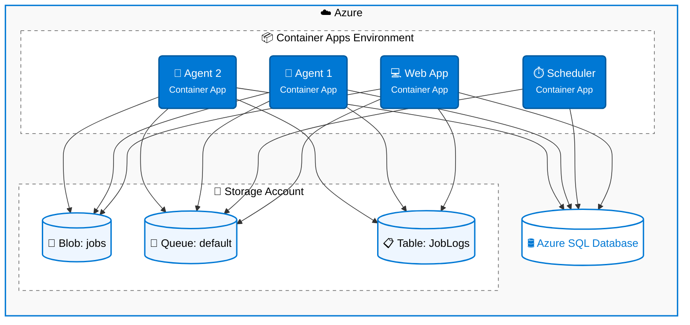
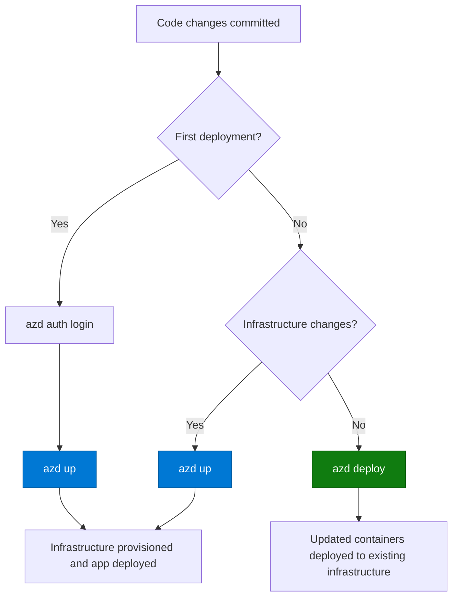
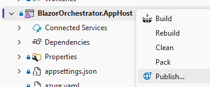

# Deployment

This guide covers deploying Blazor Data Orchestrator to production environments. The platform is designed to go from `git clone` to a fully deployed Azure Container Apps environment with a single `azd up` command — including Azure SQL, Storage, and Container Registry provisioning.

---

## Deployment Architecture



---

## Deployment Options

| Option | Description | Best For |
|--------|-------------|----------|
| **Azure Container Apps** (recommended) | Deploy via Azure Developer CLI with Aspire integration | Cloud-native, auto-scaling |
| **Azure App Service** | Deploy as App Service web apps and WebJobs | Simpler PaaS hosting |
| **Self-hosted with Docker** | Run containers on your own infrastructure | On-premises or hybrid |

---

## Azure Deployment with Azure Developer CLI

The repository includes an `azure.yaml` file at the repository root, enabling deployment via the [Azure Developer CLI (azd)](https://learn.microsoft.com/azure/developer/azure-developer-cli/overview). Run `azd` commands from the repository root. This is the recommended deployment path — it provisions all required Azure resources and deploys all services in one operation.

> **Deployed before from the `AppHost` folder?** Earlier versions also had an `azure.yaml` in `src/BlazorOrchestrator.AppHost`. It was removed so there is one azd project. If you ran `azd` from that folder, move its `.azure` folder (your azd environment) to the repository root before running `azd` again.

### One-Command Deployment

The fastest way to deploy is a single command that combines provisioning and deployment.

In the Command prompt window, or the Terminal window in `Visual Studio` or `Visual Studio Code`, navigate to the repository root (the folder that contains `azure.yaml`) and run:

```bash
azd auth login
```
After authenticating, run:

```bash
azd up
```

This command:
1. Creates all required Azure resources (Container Apps Environment, Azure SQL Database, Storage Account, Container Registry)
2. Builds and containerizes all services (Web, Scheduler, Agent)
3. Deploys everything to Azure Container Apps

No manual infrastructure setup is required. The **Aspire AppHost** defines the entire application topology, and `azd` translates it into Azure resources automatically.

### Step-by-Step Deployment

If you prefer more control, you can run each step separately (run from the repository root):

1. **Install Azure Developer CLI**

   ```bash
   winget install Microsoft.Azd
   ```

2. **Authenticate**

   ```bash
   azd auth login
   ```

3. **Initialize** (first time only - if there are issues and you are using Podman rather than docker see *Podman deployment* below)

   ```bash
   azd init
   ```

   Follow the prompts to select your Azure subscription and region.

4. **Provision infrastructure**

   ```bash
   azd provision
   ```

   This creates all required Azure resources: Container Apps Environment, Azure SQL Database, Storage Account, and Container Registry.

5. **Deploy the application**

   ```bash
   azd deploy
   ```

   This builds, containerizes, and deploys all services (Web, Scheduler, Agent) to Azure Container Apps.

### Using Existing Azure Resources

By default `azd up` creates every resource. To use resources you already have, set any of these AppHost parameters before running `azd` (for example as environment variables such as `Parameters__existingSqlServerName=my-sql-server`). An empty parameter means "create it"; the parameters are ignored when you run the app locally.

| Resource | Parameters |
|----------|------------|
| Container Apps environment | `existingAcaEnvName`, `existingAcaEnvResourceGroup` |
| Container registry | `existingAcrName`, `existingAcrResourceGroup` |
| Azure SQL server | `existingSqlServerName`, `existingSqlServerResourceGroup` |
| SQL database name | `sqlDatabaseName` (default `blazororchestratordb`) |
| Storage account | `existingStorageAccountName`, `existingStorageResourceGroup` |
| User-assigned managed identity (shared by all apps) | `existingIdentityName`, `existingIdentityResourceGroup` |
| Container app names | `webAppName`, `schedulerAppName`, `agentAppName` |
| Prebuilt agent image | `agentImage`: a `registry/repository:tag` in the environment's container registry. The agent is then deployed from that image instead of being built from its Dockerfile, so no Docker daemon is needed (BlazorData.net sets it to the release image it imported). |

A resource group parameter can be left empty when the resource is in the resource group you deploy to. The web app always uses sticky sessions (required by Blazor Server), every container app carries an `azd-service-name` tag (`webapp`, `scheduler`, `agent`), and there is exactly one agent container app.

> **Existing SQL server:** the deployment does not create database users on a SQL server it did not create. Grant each app's managed identity (or the shared identity) access to the database yourself, for example `CREATE USER [<identity-name>] FROM EXTERNAL PROVIDER; ALTER ROLE db_owner ADD MEMBER [<identity-name>];` (the Upgrade Wizard needs to change the schema).

---

## Deploy with BlazorData.net

[BlazorData.net](https://blazordata.net) installs and updates Blazor Data Orchestrator in your own Azure subscription without installing any tools on your machine.

1. **Sign in** to BlazorData.net and **connect your Azure subscription** (you approve the BlazorData.net deployment app in your Microsoft Entra tenant and grant it access to the subscription or resource group).
2. **Choose a release.** Every release on the [Releases page](https://github.com/Blazor-Data-Orchestrator/BlazorDataOrchestrator/releases) has a `deploy-manifest.json` that lists the pre-built container images (`ghcr.io/blazor-data-orchestrator/bdo-web`, `bdo-scheduler`, `bdo-agent`, pinned by digest), the tool versions it was built and tested with, and the parameters above.
3. **Choose new or existing resources** (Container Apps environment, registry, SQL server, storage account, managed identity) and the container app names.
4. **Deploy.** BlazorData.net runs `azd` from the repository root of the release source, with the tool versions from the manifest, and checks the web app's `/alive` endpoint when it is done. `/alive` answers anonymously in every environment, also while the app is waiting for setup or an upgrade.
5. **Open Blazor Data Orchestrator.** On a new install, the Install Wizard shows the database and storage connection strings as "Provided by the Azure deployment". Their values are not shown and are not written to `appsettings.json`. Create the administrator account and you are done.

### Updates

When you update to a newer release, BlazorData.net deploys the new images but **does not change the database schema**, and Blazor Data Orchestrator does not change an existing schema when it starts. Open Blazor Data Orchestrator after the update: it detects that the recorded schema version (the `SchemaVersion` setting) is older than the application and shows the **Upgrade Wizard**. Sign in as an **Admin** and select **Apply Upgrade** to run the newer `!SQL` scripts. Each script runs in its own transaction together with a record of it in the database (`[dbo].[SchemaScriptHistory]` and `[dbo].[SchemaVersionState]`), so a script that has been applied never runs again, even if the wizard is retried. Only one upgrade can run at a time (other replicas or sessions wait for it). Back up the database first.

If the wizard reports that upgrade scripts are missing, the deployment is incomplete: redeploy the release instead of continuing.

### Release versions

Release tags match the application version: `v1.60.0` is `ApplicationVersion.Current` `01.60.00`, which is also the content of the `SQLVersion` file. A `!SQL` script is added only when the schema changes and is named after the version that introduces it (for example `01.20.00.sql`), so the newest script may be older than the release but never newer. The `release.yml` workflow builds a release when a `v*.*.*` tag is pushed: it checks these rules (`build/Check-Version.ps1`), runs the tests, pushes the three images to GHCR, and attaches `deploy-manifest.json` and `infra-snapshot.zip` (the `aspire publish` output) to the GitHub Release.

---

## Azure Resources Required (automatically created for you with `azd deploy`)

| Resource | Service | Purpose |
|----------|---------|---------|
| **Azure SQL Database** | Azure SQL | Job definitions, schedules, instances, users |
| **Azure Storage Account** | Blob, Queue, Table | Job packages, execution queue, structured logs |
| **Azure Container Apps** | Web App | Blazor Server web application |
| **Azure Container Apps** | Scheduler | Background scheduling service |
| **Azure Container Apps** | Agent (1+ replicas) | Job execution workers |
| **Azure Container Registry** | Registry | Container image storage |

---

## Configuration for Production (automatically set by `azd deploy`)

### Connection Strings

Set connection strings as environment variables or app settings on each Container App:

| Setting | Description |
|---------|-------------|
| `ConnectionStrings__blazororchestratordb` | Azure SQL connection string |
| `ConnectionStrings__blobs` | Azure Storage connection string for Blob |
| `ConnectionStrings__queues` | Azure Storage connection string for Queue |
| `ConnectionStrings__tables` | Azure Storage connection string for Table |

### Agent Configuration

Configure each agent instance via environment variables:

| Setting | Description | Default |
|---------|-------------|---------|
| `QueueName` | The queue this agent monitors | `default` |

### Scaling Agents

You can scale agents horizontally by deploying multiple replicas or multiple Container Apps with different `QueueName` configurations. For example:

- **Default pool**: 2 replicas monitoring the `default` queue
- **Large job pool**: 1 replica monitoring `jobs-large-container` with more CPU/memory allocated

### Updating a Deployed Instance

After the initial deployment with `azd up`, use `azd deploy` for all subsequent updates. This rebuilds and redeploys all services without re-provisioning infrastructure.

From the repository root, run:

```bash
azd deploy
```

This command:
1. Builds all projects (Web, Scheduler, Agent)
2. Containerizes the services
3. Pushes updated images to Azure Container Registry
4. Deploys updated containers to Azure Container Apps

**When to use each command:**

| Command | Use When |
|---------|----------|
| `azd up` | First-time deployment (provisions infrastructure + deploys) |
| `azd deploy` | Updating an existing deployment with code or configuration changes |
| `azd provision` | Updating only infrastructure (e.g., adding new Azure resources) |

> **Note:** If you have changed the Aspire AppHost topology (added or removed services/resources in `Program.cs`), run `azd up` instead to ensure infrastructure is updated.

**Deploying a single service:**

To deploy only one service (e.g., after a change to only the web app):

```bash
azd deploy webapp
```

Service names match those defined in the AppHost: `webapp`, `scheduler`, `agent`.



> **Alternative: Visual Studio Publish**
>
> You can also publish from Visual Studio by right-clicking the AppHost project and selecting **Publish**. However, `azd deploy` is the recommended approach as it is scriptable, repeatable, and consistent with the initial deployment workflow.
>
> 

### External Authentication Redirect URIs

When deploying to Azure Container Apps, external authentication redirect URIs must use the Container App's fully qualified domain name (FQDN):

| Provider | Redirect URI Pattern |
|----------|---------------------|
| Microsoft | `https://<container-app-fqdn>/signin-microsoft` |
| Google | `https://<container-app-fqdn>/signin-google` |

The FQDN is assigned by Azure Container Apps after deployment. Retrieve it from the Azure Portal or via:

```bash
az containerapp show --name <webapp-name> --resource-group <rg-name> --query properties.configuration.ingress.fqdn -o tsv
```

If using a custom domain, use that domain in the redirect URIs instead. Update the redirect URIs in your Azure Entra ID app registration and/or Google Cloud Console credentials to match.

### Podman deployment

If having issues deploying when using Podman the following may be required when running *azd* (run in Powershell):

$env:PATH += ";$env:LOCALAPPDATA\Programs\Azure Dev CLI"

$env:AZURE_DEV_CONTAINER_TOOL = "podman"

azd up

---

*Back to [Home](https://github.com/Blazor-Data-Orchestrator/BlazorDataOrchestrator/wiki/Home)*
