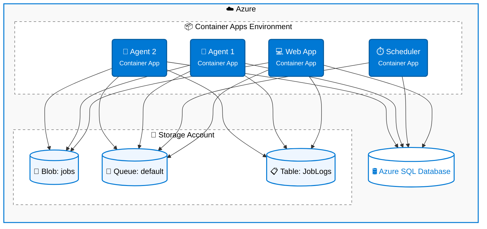

# Deployment

This guide covers deploying Blazor Data Orchestrator to production environments. The platform is designed to go from `git clone` to a fully deployed Azure Container Apps environment with a single `azd up` command — including Azure SQL, Storage, and Container Registry provisioning.

---

## Deployment Architecture



---

## Deployment Options

| Option | Description | Best For |
|--------|-------------|----------|
| **Azure Container Apps** (recommended) | Deploy via Azure Developer CLI with Aspire integration | Cloud-native, auto-scaling |
| **Azure App Service** | Deploy as App Service web apps and WebJobs | Simpler PaaS hosting |
| **Self-hosted with Docker** | Run containers on your own infrastructure | On-premises or hybrid |

---

## Azure Deployment with Azure Developer CLI

The repository includes an `azure.yaml` file at the repository root, enabling deployment via the [Azure Developer CLI (azd)](https://learn.microsoft.com/azure/developer/azure-developer-cli/overview). Run `azd` commands from the repository root. This is the recommended deployment path — it provisions all required Azure resources and deploys all services in one operation.

### One-Command Deployment

The fastest way to deploy is a single command that combines provisioning and deployment:

```bash
azd up
```

This command:
1. Creates all required Azure resources (Container Apps Environment, Azure SQL Database, Storage Account, Container Registry)
2. Builds and containerizes all services (Web, Scheduler, Agent)
3. Deploys everything to Azure Container Apps

No manual infrastructure setup is required. The Aspire AppHost defines the entire application topology, and `azd` translates it into Azure resources automatically.

### Step-by-Step Deployment

If you prefer more control, you can run each step separately:

1. **Install Azure Developer CLI**

   ```bash
   winget install Microsoft.Azd
   ```

2. **Authenticate**

   ```bash
   azd auth login
   ```

3. **Initialize** (first time only)

   ```bash
   azd init
   ```

   Follow the prompts to select your Azure subscription and region.

4. **Provision infrastructure**

   ```bash
   azd provision
   ```

   This creates all required Azure resources: Container Apps Environment, Azure SQL Database, Storage Account, and Container Registry.

5. **Deploy the application**

   ```bash
   azd deploy
   ```

   This builds, containerizes, and deploys all services (Web, Scheduler, Agent) to Azure Container Apps.

### Using Existing Azure Resources

By default `azd up` creates every resource. To use resources you already have, set any of these AppHost parameters before running `azd` (for example as environment variables such as `Parameters__existingSqlServerName=my-sql-server`). An empty parameter means "create it"; the parameters are ignored when you run the app locally.

| Resource | Parameters |
|----------|------------|
| Container Apps environment | `existingAcaEnvName`, `existingAcaEnvResourceGroup` |
| Container registry | `existingAcrName`, `existingAcrResourceGroup` |
| Azure SQL server | `existingSqlServerName`, `existingSqlServerResourceGroup` |
| SQL database name | `sqlDatabaseName` (default `blazororchestratordb`) |
| Storage account | `existingStorageAccountName`, `existingStorageResourceGroup` |
| User-assigned managed identity (shared by all apps) | `existingIdentityName`, `existingIdentityResourceGroup` |
| Container app names | `webAppName`, `schedulerAppName`, `agentAppName` |

A resource group parameter can be left empty when the resource is in the resource group you deploy to. The web app always uses sticky sessions (required by Blazor Server), and there is exactly one agent container app.

> **Existing SQL server:** the deployment does not create database users on a SQL server it did not create. Grant each app's managed identity (or the shared identity) access to the database yourself, for example `CREATE USER [<identity-name>] FROM EXTERNAL PROVIDER; ALTER ROLE db_owner ADD MEMBER [<identity-name>];` (the same role Aspire grants on servers it creates; the Upgrade Wizard needs it to change the schema).

---

## Deploy with BlazorData.net

[BlazorData.net](https://blazordata.net) installs and updates Blazor Data Orchestrator in your own Azure subscription without installing any tools on your machine.

1. **Sign in** to BlazorData.net and **connect your Azure subscription** (you approve the BlazorData.net deployment app in your Microsoft Entra tenant and grant it access to the subscription or resource group).
2. **Choose a release.** Every release on the [Releases page](https://github.com/Blazor-Data-Orchestrator/BlazorDataOrchestrator/releases) has a `deploy-manifest.json` that lists the pre-built container images (`ghcr.io/blazor-data-orchestrator/bdo-web`, `bdo-scheduler`, `bdo-agent`), the tool versions it was tested with, and the parameters above.
3. **Choose new or existing resources** (Container Apps environment, registry, SQL server, storage account, managed identity) and the container app names.
4. **Deploy.** BlazorData.net runs `azd` from the repository root of the release source, with the tool versions from the manifest, and checks the web app's `/alive` endpoint when it is done.
5. **Open Blazor Data Orchestrator.** On a new install, the Install Wizard shows the database and storage connection strings as "Provided by Azure deployment" (they are not written to `appsettings.json`). Create the administrator account and you are done.

### Updates

When you update to a newer release, BlazorData.net deploys the new images but **does not change the database schema**. Open Blazor Data Orchestrator after the update: it detects that the database (`[dbo].[SchemaVersion]`) is older than the application and shows the **Upgrade Wizard**. Sign in as an **Administrator** and select **Apply Upgrade** to run the newer `!SQL` scripts. Each script runs in a transaction; back up the database first.

### Release versions

Release tags (`v1.0.0`) match the application version (`01.00.00`) in `ApplicationVersion.Current`, the `SQLVersion` file and the newest `!SQL` script. The `release.yml` workflow builds a release when a `v*.*.*` tag is pushed.

---

## Azure Resources Required

| Resource | Service | Purpose |
|----------|---------|---------|
| **Azure SQL Database** | Azure SQL | Job definitions, schedules, instances, users |
| **Azure Storage Account** | Blob, Queue, Table | Job packages, execution queue, structured logs |
| **Azure Container Apps** | Web App | Blazor Server web application |
| **Azure Container Apps** | Scheduler | Background scheduling service |
| **Azure Container Apps** | Agent (1+ replicas) | Job execution workers |
| **Azure Container Registry** | Registry | Container image storage |

---

## Configuration for Production

### Connection Strings

Set connection strings as environment variables or app settings on each Container App:

| Setting | Description |
|---------|-------------|
| `ConnectionStrings__blazororchestratordb` | Azure SQL connection string |
| `ConnectionStrings__blobs` | Azure Storage connection string for Blob |
| `ConnectionStrings__queues` | Azure Storage connection string for Queue |
| `ConnectionStrings__tables` | Azure Storage connection string for Table |

### Agent Configuration

Configure each agent instance via environment variables:

| Setting | Description | Default |
|---------|-------------|---------|
| `QueueName` | The queue this agent monitors | `default` |

### Scaling Agents

You can scale agents horizontally by deploying multiple replicas or multiple Container Apps with different `QueueName` configurations. For example:

- **Default pool**: 2 replicas monitoring the `default` queue
- **Large job pool**: 1 replica monitoring `jobs-large-container` with more CPU/memory allocated

---

## CI/CD

### Wiki Content Synchronization

Wiki content in the `wiki-content/` directory is automatically synchronized to the GitHub Wiki via the `update-wiki.yml` GitHub Action. Any changes pushed to `wiki-content/` on the `main` branch are reflected in the wiki.

### Application Deployment Pipeline

Use `azd pipeline config` to set up a CI/CD pipeline in GitHub Actions:

```bash
azd pipeline config
```

This generates a GitHub Actions workflow that runs `azd provision` and `azd deploy` on each push to the main branch.

---

## Self-Hosted Deployment

For on-premises or non-Azure deployments:

1. **Build container images:**

   ```bash
   docker compose build
   ```

2. **Configure environment variables** for SQL Server and Azure Storage (or use a compatible storage emulator).

3. **Run services** using Docker Compose or your container orchestrator (Kubernetes, Docker Swarm, etc.).

4. **Database setup** — Point the connection string to your SQL Server instance. The Install Wizard handles schema creation on first launch.

---

*Back to [Home](https://github.com/Blazor-Data-Orchestrator/BlazorDataOrchestrator/wiki/Home)*
